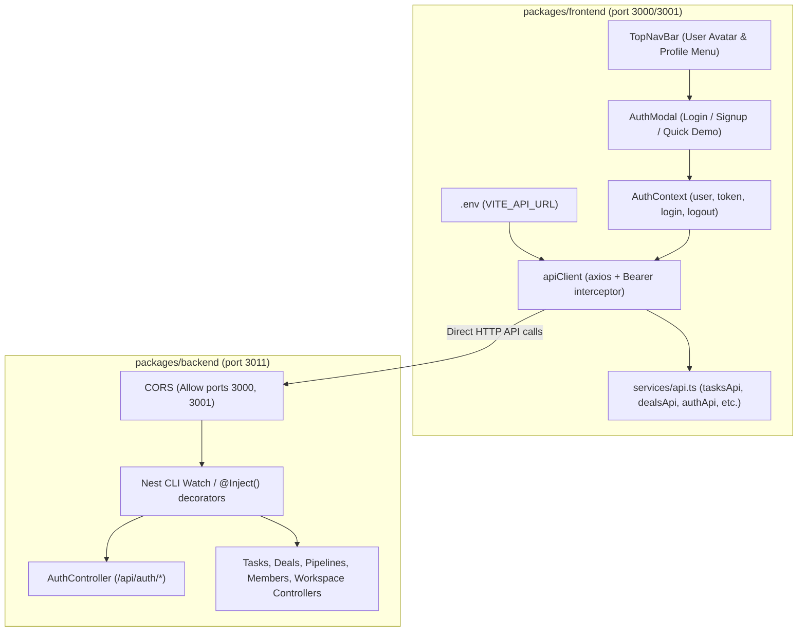

# Axios Direct API Migration, Controller DI Fix & Login Screen Implementation Plan

> **For agentic workers:** REQUIRED SUB-SKILL: Use superpowers:subagent-driven-development (recommended) or superpowers:executing-plans to implement this plan task-by-task. Steps use checkbox (`- [ ]`) syntax for tracking.

**Goal:** Resolve the NestJS controller dependency injection errors (`Cannot read properties of undefined (reading 'findAll')`), replace Vite's HTTP proxy with a direct Axios client driven by `VITE_API_URL` in `.env`, implement the missing Login/Signup screen and authentication state, update backend CORS, and fix shared deal types.

**Architecture:** 
1. **Backend DI Fix:** Add explicit `@Inject(...)` decorators to all NestJS controllers and update backend `start:dev` to `nest start --watch` so parameter type metadata is reliably preserved.
2. **Direct Axios API Client:** Frontend transitions from relative fetch calls through Vite dev proxy to a configured Axios client reading `import.meta.env.VITE_API_URL` (defaulting to `http://localhost:3011/api`), with automated `Authorization: Bearer <token>` request interceptor.
3. **Authentication & Login Screen:** Create `AuthModal` / `LoginModal` component with Login and Signup tabs, a "Quick Demo Login" button pre-configured with `alex@backnode.io` / `Password123!`, integrated with `AuthContext` and user profile dropdown in `TopNavBar`.
4. **CORS & Types:** Allow all local development origins (`3000`, `3001`) in backend CORS and add `pipelineId?: string` to `CrmDeal` in `packages/shared`.

**Tech Stack:** TypeScript, React 19, Vite, Axios, NestJS 10, TypeORM, Tailwind CSS v4, Lucide React.

---

## Root Cause Analysis

### 1. `Cannot read properties of undefined (reading 'findAll')`
When running `tsx watch src/main.ts`, `tsx` (powered by esbuild) strips TypeScript's `design:paramtypes` decorator metadata. Consequently, NestJS cannot automatically infer the service type in controller constructors like `constructor(private readonly tasksService: TasksService)`. Injected services resolve as `undefined`, causing `TypeError: Cannot read properties of undefined (reading 'findAll')`. Adding explicit `@Inject(TasksService)` and switching to `nest start --watch` solves this permanently.

### 2. Missing Login Screen
While the NestJS backend has complete authentication endpoints (`/api/auth/login`, `signup`, `refresh`, `logout`, `me`), the frontend completely lacks a login UI or authentication state. Users had no way to authenticate, switch workspaces, or view their account credentials.

---

## User Review Required

> [!IMPORTANT]
> - **Login Screen & Quick Demo Login:** We are adding a new `AuthModal` supporting both Email/Password login, new workspace registration, and a 1-click **Demo Login (`alex@backnode.io`)** button for immediate testing.
> - **Authentication Flow:** When logged in, the JWT access token is stored and automatically sent in Axios `Authorization: Bearer <token>` headers. The `TopNavBar` user avatar opens an operator profile popover showing account info and a Log In / Log Out button.
> - **Backend `start:dev` Script:** Updated to `"nest start --watch"` to ensure full decorator metadata compilation and native NestJS hot reloading.
> - **Vite Proxy Removed:** Direct Axios client points to `VITE_API_URL=http://localhost:3011/api`.

---

## Proposed Changes



---

### Shared Package (`packages/shared`)

#### [MODIFY] packages/shared/src/types.ts
- Add optional `pipelineId?: string;` to `CrmDeal` interface.
- Rebuild via `yarn workspace @backnode/shared build`.

---

### Backend Package (`packages/backend`)

#### [MODIFY] packages/backend/src/tasks/tasks.controller.ts
- Add `@Inject(TasksService)` to constructor.

#### [MODIFY] packages/backend/src/deals/deals.controller.ts
- Add `@Inject(DealsService)` to constructor.

#### [MODIFY] packages/backend/src/pipelines/pipelines.controller.ts
- Add `@Inject(PipelinesService)` to constructor.

#### [MODIFY] packages/backend/src/members/members.controller.ts
- Add `@Inject(MembersService)` to constructor.

#### [MODIFY] packages/backend/src/contacts/contacts.controller.ts
- Add `@Inject(ContactsService)` to constructor.

#### [MODIFY] packages/backend/src/workspace/workspace.controller.ts
- Add `@Inject(WorkspaceService)` to constructor.

#### [MODIFY] packages/backend/src/auth/auth.controller.ts
- Add `@Inject(AuthService)` to constructor.

#### [MODIFY] packages/backend/src/auth/auth.service.ts
- Add `@Inject(JwtService)` to `jwtService` constructor parameter.

#### [MODIFY] packages/backend/src/main.ts
- Broaden CORS origin to accept `localhost:3000`, `localhost:3001`, and regex for local dev ports.

#### [MODIFY] packages/backend/package.json
- Update `"start:dev"` to `"nest start --watch"`.

---

### Frontend Package (`packages/frontend`)

#### [MODIFY] packages/frontend/package.json
- Add `axios` dependency.

#### [NEW] packages/frontend/.env
- Set `VITE_API_URL=http://localhost:3011/api`.

#### [NEW] packages/frontend/.env.example
- Set `VITE_API_URL=http://localhost:3011/api`.

#### [MODIFY] packages/frontend/vite.config.ts
- Remove `proxy` configuration from `server`.

#### [NEW] packages/frontend/src/context/AuthContext.tsx
- Create React Context managing `user`, `token`, `isAuthenticated`, `login`, `signup`, `logout`, and persistent session restoration via `authApi.getMe()`.

#### [NEW] packages/frontend/src/components/AuthModal.tsx
- Design Cyber-Enterprise themed modal with Login and Register tabs, input validation, error alerts, and a **1-Click Demo Login** button (`alex@backnode.io`).

#### [MODIFY] packages/frontend/src/services/api.ts
- Build Axios instance with `baseURL: import.meta.env.VITE_API_URL || 'http://localhost:3011/api'`.
- Add request interceptor attaching `Authorization: Bearer <token>`.
- Add `authApi` (`login`, `signup`, `getMe`, `logout`).
- Refactor all existing APIs (`tasksApi`, `dealsApi`, `pipelinesApi`, `membersApi`, `contactsApi`, `workspaceApi`) to Axios.

#### [MODIFY] packages/frontend/src/components/TopNavBar.tsx
- Update user avatar into an interactive Operator Profile menu displaying current user name, email, role, workspace name, and "Log In" / "Switch Account" / "Log Out" triggers.

#### [MODIFY] packages/frontend/src/App.tsx
- Wrap application with `AuthProvider` (or integrate auth state).
- Mount `AuthModal` when prompted from `TopNavBar` or when unauthenticated user wants to sign in.

---

## Step-by-Step Tasks

### Task 1: Fix Shared Types and Rebuild `@backnode/shared`

**Files:**
- Modify: `packages/shared/src/types.ts:190-215`

- [x] **Step 1: Add `pipelineId?: string;` to `CrmDeal` interface**

In `packages/shared/src/types.ts`:
```typescript
export interface CrmDeal {
  id: string;
  title: string;
  company: string;
  value: number;
  formattedValue: string;
  stage: 'Qualified Lead' | 'Discovery & Demo' | 'Proposal Submitted' | 'Contract & Legal' | 'Closed Won';
  probability: number;
  targetCloseDate: string;
  contact: {
    name: string;
    title: string;
    email: string;
    phone: string;
    location: string;
    role: string;
    initials: string;
  };
  owner: string;
  ownerInitials: string;
  tags: string[];
  nextStep?: string;
  pipelineId?: string;
  linkedTasks: CrmLinkedTask[];
  history: CrmHistoryEvent[];
  accountId?: string;
}
```

- [x] **Step 2: Rebuild shared package**

Run: `yarn workspace @backnode/shared build`
Expected: Success, generates `packages/shared/dist/index.d.ts`.

---

### Task 2: Fix Backend Controller Dependency Injections & CORS

**Files:**
- Modify: `packages/backend/src/tasks/tasks.controller.ts`
- Modify: `packages/backend/src/deals/deals.controller.ts`
- Modify: `packages/backend/src/pipelines/pipelines.controller.ts`
- Modify: `packages/backend/src/members/members.controller.ts`
- Modify: `packages/backend/src/contacts/contacts.controller.ts`
- Modify: `packages/backend/src/workspace/workspace.controller.ts`
- Modify: `packages/backend/src/auth/auth.controller.ts`
- Modify: `packages/backend/src/auth/auth.service.ts`
- Modify: `packages/backend/src/main.ts`
- Modify: `packages/backend/package.json`

- [x] **Step 1: Add `@Inject(...)` to all controller constructors**

Example in `packages/backend/src/tasks/tasks.controller.ts`:
```typescript
import { Controller, Get, Post, Patch, Delete, Body, Param, Query, UseGuards, Inject } from '@nestjs/common';
import { TasksService } from './tasks.service';
...
export class TasksController {
  constructor(@Inject(TasksService) private readonly tasksService: TasksService) {}
```
(Apply symmetrically with `Inject` for `DealsService`, `PipelinesService`, `MembersService`, `ContactsService`, `WorkspaceService`, `AuthService`, and `JwtService`).

- [x] **Step 2: Update CORS in `packages/backend/src/main.ts`**

```typescript
  const allowedOrigins = [
    'http://localhost:3000',
    'http://127.0.0.1:3000',
    'http://localhost:3001',
    'http://127.0.0.1:3001',
    process.env.FRONTEND_URL,
  ].filter(Boolean) as string[];

  app.enableCors({
    origin: (origin, callback) => {
      if (!origin) return callback(null, true);
      if (
        allowedOrigins.includes(origin) ||
        /^http:\/\/localhost:\d+$/.test(origin) ||
        /^http:\/\/127\.0\.0\.1:\d+$/.test(origin)
      ) {
        return callback(null, true);
      }
      return callback(new Error('Not allowed by CORS'));
    },
    methods: 'GET,HEAD,PUT,PATCH,POST,DELETE,OPTIONS',
    credentials: true,
  });
```

- [x] **Step 3: Update `start:dev` in `packages/backend/package.json`**

Change `"start:dev": "tsx watch src/main.ts"` to `"start:dev": "nest start --watch"`.

- [x] **Step 4: Build backend to verify compilation**

Run: `yarn workspace @backnode/backend build`
Expected: Exits with code 0.

---

### Task 3: Install `axios` and Configure Frontend Environment

**Files:**
- Modify: `packages/frontend/package.json`
- Create: `packages/frontend/.env`
- Create: `packages/frontend/.env.example`
- Modify: `packages/frontend/vite.config.ts`

- [x] **Step 1: Install axios**

Run: `yarn workspace @backnode/frontend add axios`

- [x] **Step 2: Create `packages/frontend/.env`**

```env
VITE_API_URL=http://localhost:3011/api
```

- [x] **Step 3: Create `packages/frontend/.env.example`**

```env
VITE_API_URL=http://localhost:3011/api
```

- [x] **Step 4: Remove proxy from `packages/frontend/vite.config.ts`**

Remove the `proxy` property from `server`.

---

### Task 4: Refactor Frontend API Client with Auth Interceptor

**Files:**
- Modify: `packages/frontend/src/services/api.ts`

- [x] **Step 1: Implement `apiClient`, `authApi`, and refactor entity APIs**

Add `authApi`:
```typescript
export const authApi = {
  login: async (dto: LoginDto): Promise<AuthResponse> => {
    const res = await apiClient.post<AuthResponse>('/auth/login', dto);
    return res.data;
  },
  signup: async (dto: SignupDto): Promise<AuthResponse> => {
    const res = await apiClient.post<AuthResponse>('/auth/signup', dto);
    return res.data;
  },
  getMe: async (): Promise<User> => {
    const res = await apiClient.get<User>('/auth/me');
    return res.data;
  },
  logout: async (): Promise<void> => {
    await apiClient.post('/auth/logout');
  },
};
```
Add Axios request interceptor:
```typescript
apiClient.interceptors.request.use((config) => {
  const token = localStorage.getItem('backnode_token');
  if (token && config.headers) {
    config.headers.Authorization = `Bearer ${token}`;
  }
  return config;
});
```

---

### Task 5: Implement `AuthContext` and `AuthModal`

**Files:**
- Create: `packages/frontend/src/context/AuthContext.tsx`
- Create: `packages/frontend/src/components/AuthModal.tsx`

- [x] **Step 1: Create `AuthContext.tsx`**

Provides:
- `user: User | null`
- `token: string | null`
- `isAuthenticated: boolean`
- `isAuthModalOpen: boolean`
- `setIsAuthModalOpen(open: boolean): void`
- `login(email, password): Promise<void>`
- `signup(dto): Promise<void>`
- `logout(): Promise<void>`

- [x] **Step 2: Create `AuthModal.tsx`**

Features:
- Tabs for "Log In" and "Create Workspace"
- "Quick Demo Login (Alex Wong)" prefill button for zero-effort sign in
- Clean error messaging and loading indicators
- Modern Backnode OS neo-brutalist / cyberpunk styling

---

### Task 6: Integrate Auth into `TopNavBar` and `App.tsx`

**Files:**
- Modify: `packages/frontend/src/components/TopNavBar.tsx`
- Modify: `packages/frontend/src/App.tsx`

- [x] **Step 1: Update `TopNavBar.tsx` Operator Avatar**

Clicking the avatar opens a popover showing:
- Operator Name & Email
- Role Badge (e.g. `OWNER`, `MEMBER`)
- Workspace Name (e.g. `Backnode Core`)
- "Log In / Switch Account" and "Sign Out" actions.

- [x] **Step 2: Connect `AuthModal` and refresh data upon login in `App.tsx`**

When a user logs in or switches accounts, re-fetch workspace data so the view updates instantly.

---

## Verification Plan

### Automated Verification
1. `yarn workspace @backnode/shared build`
2. `yarn workspace @backnode/backend build`
3. `yarn workspace @backnode/frontend lint`
4. `yarn workspace @backnode/frontend build`

### Manual Verification
1. Run `yarn dev` (or check terminal running both frontend and backend).
2. Confirm the backend terminal shows:
   - No `Cannot read properties of undefined (reading 'findAll')` errors!
   - Nest application successfully handles GET `/api/tasks`, `/api/deals`, etc. with 200 OK.
3. Open `http://localhost:3000` (or `3001`):
   - Confirm network requests hit `http://localhost:3011/api/*` directly via Axios.
   - Vite proxy error logs are completely gone.
4. Click on the Operator Avatar (or "Log In" button) in `TopNavBar`:
   - Open the new `AuthModal`.
   - Click "Quick Demo Login" -> Logs in as Alex Wong (`alex@backnode.io`).
   - Profile popover displays user name, email, and role.
