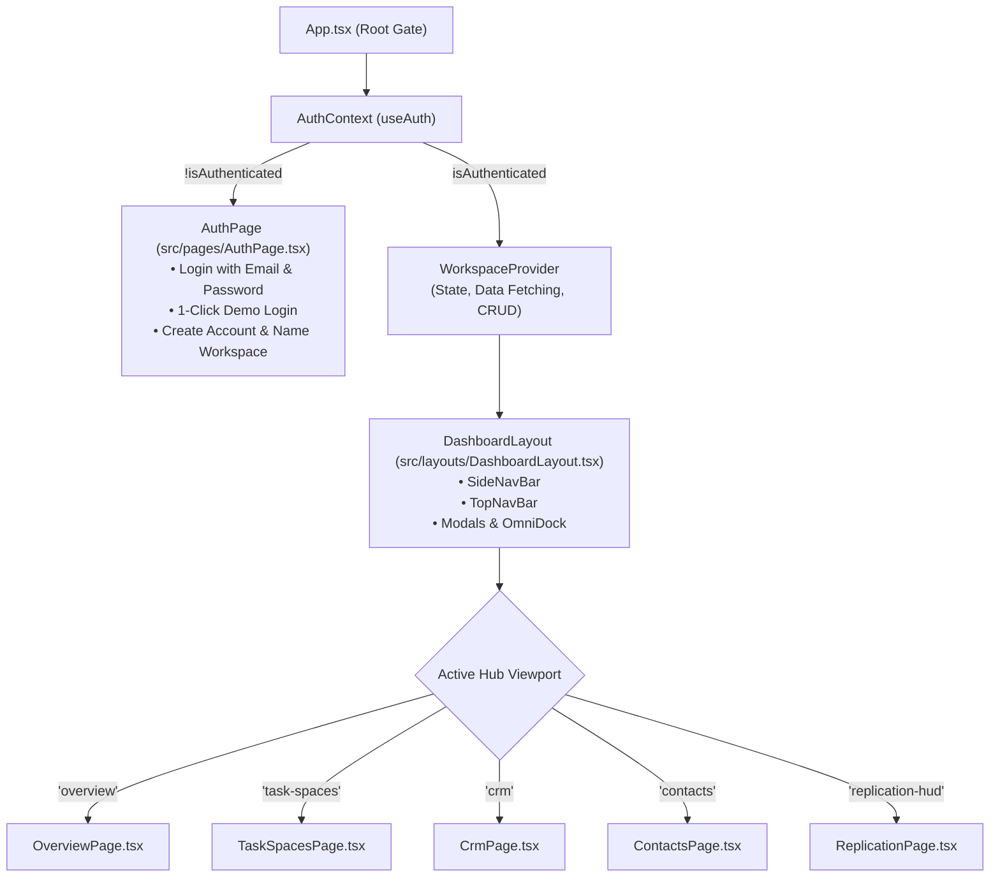

# Modular Pages Architecture & Authentication Gate Implementation Plan

> **For agentic workers:** REQUIRED SUB-SKILL: Use superpowers:subagent-driven-development (recommended) or superpowers:executing-plans to implement this plan task-by-task. Steps use checkbox (`- [ ]`) syntax for tracking.

**Goal:** Decompose the monolithic 856-line `App.tsx` into individual page components and a clean dashboard layout, and enforce a strict authentication gate that routes unauthenticated users to a dedicated Login/Signup screen until they authenticate or create and name their new account.

**Architecture:** 
1. **Authentication Gate:** `App.tsx` checks `useAuth()`. If `!isAuthenticated`, it immediately renders `AuthPage` (full-screen login & signup with workspace/account naming).
2. **Workspace State Decoupling:** Extract workspace state, filters, and mutations out of `App.tsx` into `WorkspaceContext` (`packages/frontend/src/context/WorkspaceContext.tsx`), eliminating prop-drilling.
3. **Modular Page Components (`packages/frontend/src/pages/`):**
   - `AuthPage.tsx`: Full-screen authentication portal with Login, 1-Click Demo Login, and Signup (Full Name, Account Name, Email, Password).
   - `OverviewPage.tsx`: Command Cockpit and Executive Summary dashboards.
   - `TaskSpacesPage.tsx`: Views bar, Kanban board, List, Table, Gantt Timeline, Monthly Calendar, Docs canvas, Settings, and TaskInspector.
   - `CrmPage.tsx`: CRM Pipeline Dashboard, Kanban board, Deal Inspector, and Pipeline Settings.
   - `ContactsPage.tsx`: Directory & Contacts management.
   - `ReplicationPage.tsx`: Replication HUD & Cluster synchronization.
4. **Dashboard Layout (`packages/frontend/src/layouts/DashboardLayout.tsx`):** Unifies `SideNavBar`, `TopNavBar`, floating OmniDock, and global modals around the active page viewport.

**Tech Stack:** React 19, TypeScript, Tailwind CSS v4, Axios, NestJS 10, TypeORM.

---

## User Review Required

> [!IMPORTANT]
> - **Strict Authentication Gate:** Unauthenticated users will no longer see the dashboard with mock data by default. They will land directly on the **Backnode OS Login & Workspace Signup Screen** (`AuthPage`).
> - **Account Naming on Signup:** When a new user signs up, they provide their Full Name, Account/Workspace Name, Work Email, and Password. The backend creates the new account with that name, provisions starter data, logs them in, and automatically transitions them to their new dashboard.
> - **Quick Demo Login Preserved:** For frictionless testing, a 1-click **Quick Demo Login (Alex Wong • Backnode Core)** button remains available on the login page.
> - **Modular Pages:** `App.tsx` is reduced from 856 lines to ~50 lines, delegating hub rendering to dedicated page components in `src/pages/`.

---

## Proposed Architecture

---

## File Structure & Responsibilities

| File Path | Responsibility |
|---|---|
| `packages/frontend/src/pages/AuthPage.tsx` | Dedicated full-page authentication portal (Login, Quick Demo, Workspace Signup). |
| `packages/frontend/src/context/WorkspaceContext.tsx` | Centralizes task, deal, pipeline, member, contact, folder data fetching, filters, active space/hub state, and API operations. |
| `packages/frontend/src/layouts/DashboardLayout.tsx` | Hosts standard chrome (`SideNavBar`, `TopNavBar`, OmniDock, Modals, CommandPalette) around the active page. |
| `packages/frontend/src/pages/OverviewPage.tsx` | Hosts `ExecutiveCockpitView` and `OverviewView`. |
| `packages/frontend/src/pages/TaskSpacesPage.tsx` | Hosts `TaskSpaceViewsBar`, `TaskSpaceDashboardView`, `KanbanBoard`, `ListView`, `DeliverablesTableView`, `GanttTimelineView`, `MonthlyCalendarView`, `DocsCanvasView`, `TaskSpaceSettings`, and `TaskInspector`. |
| `packages/frontend/src/pages/CrmPage.tsx` | Hosts `CrmDashboardView`, `PipelineCrmView`, and `DealInspector`. |
| `packages/frontend/src/pages/ContactsPage.tsx` | Hosts `ContactsDirectoryView`. |
| `packages/frontend/src/pages/ReplicationPage.tsx` | Hosts `ReplicationHudView`. |
| `packages/frontend/src/App.tsx` | Root auth gating and provider mounting. |

---

## Step-by-Step Implementation Tasks

### Task 1: Create Full-Screen `AuthPage.tsx`

**Files:**
- Create: `packages/frontend/src/pages/AuthPage.tsx`

- [ ] **Step 1: Implement `AuthPage.tsx`**

Features:
- Dual-mode card: **Operator Sign In** and **Create Account & Workspace**.
- Prominent input for **Workspace / Organization Name** on signup ("Once the user signs up and names their account then let the user reach the dashboard").
- 1-Click **Quick Demo Login** button pre-filled with Alex Wong (`alex@backnode.io` / `Password123!`).
- Error banner for invalid credentials or email collisions.
- Backnode OS neo-brutalist / cyberpunk styling matching the application aesthetic.

---

### Task 2: Create `WorkspaceContext.tsx`

**Files:**
- Create: `packages/frontend/src/context/WorkspaceContext.tsx`

- [ ] **Step 1: Implement `WorkspaceContext.tsx`**

Provides:
- Data state: `tasks`, `statuses`, `listSettings`, `members`, `directoryContacts`, `folders`, `syncStatus`, `pipelines`, `activePipelineId`, `deals`, `crmStages`, `crmSettings`.
- Navigation state: `currentHub`, `setCurrentHub`, `currentView`, `setCurrentView`, `activeSpace`, `setActiveSpace`, `overviewMode`, `setOverviewMode`, `selectedTaskId`, `setSelectedTaskId`, `selectedDealId`, `setSelectedDealId`, `crmView`, `setCrmView`.
- Filter state: `searchQuery`, `setSearchQuery`, `filterPriority`, `setFilterPriority`, `filterStatus`, `setFilterStatus`, `filterAssignee`, `setFilterAssignee`, `quickFilter`, `setQuickFilter`, `taskGroupBy`, `setTaskGroupBy`, `crmFilterStage`, `setCrmFilterStage`, `crmFilterOwner`, `setCrmFilterOwner`, `handleClearAllFilters`.
- Modal state: `isNewItemModalOpen`, `isNewFolderModalOpen`, `isNewPipelineModalOpen`, `isNewContactModalOpen`, `isCommandPaletteOpen`, `taskToDelete`, `setTaskToDelete`.
- CRUD actions: `handleCreateTask`, `handleUpdateTask`, `handleDeleteTask`, `handleCreateDeal`, `handleUpdateDeal`, `handleAdvanceDealStage`, `handleMoveTaskStatus`, `handleUpdateListSettings`, `handleUpdateStatuses`, `handleUpdateCrmSettings`, `handleUpdateCrmStages`.
- Computed `filteredTasks`, `selectedTask`, `selectedDeal`, `activePipeline`.

---

### Task 3: Create Individual Page Components in `src/pages/`

**Files:**
- Create: `packages/frontend/src/pages/OverviewPage.tsx`
- Create: `packages/frontend/src/pages/TaskSpacesPage.tsx`
- Create: `packages/frontend/src/pages/CrmPage.tsx`
- Create: `packages/frontend/src/pages/ContactsPage.tsx`
- Create: `packages/frontend/src/pages/ReplicationPage.tsx`

- [ ] **Step 1: Create `OverviewPage.tsx`**
  - Switches between `ExecutiveCockpitView` and `OverviewView` according to `overviewMode`.

- [ ] **Step 2: Create `TaskSpacesPage.tsx`**
  - Renders `TaskSpaceViewsBar` when not in dashboard view.
  - Switches viewports: `TaskSpaceDashboardView`, `KanbanBoard`, `ListView`, `DeliverablesTableView`, `GanttTimelineView`, `MonthlyCalendarView`, `DocsCanvasView`, `TaskSpaceSettings`.
  - Renders `TaskInspector` slide-over when a task is selected.

- [ ] **Step 3: Create `CrmPage.tsx`**
  - Switches between `CrmDashboardView` and `PipelineCrmView` (Kanban, List, Table, Analytics, Settings).
  - Renders `DealInspector` slide-over when a deal is selected.

- [ ] **Step 4: Create `ContactsPage.tsx`**
  - Renders `ContactsDirectoryView`.

- [ ] **Step 5: Create `ReplicationPage.tsx`**
  - Renders `ReplicationHudView`.

---

### Task 4: Create `DashboardLayout.tsx`

**Files:**
- Create: `packages/frontend/src/layouts/DashboardLayout.tsx`

- [ ] **Step 1: Implement `DashboardLayout.tsx`**
  - Wraps the active page in `SideNavBar` and `TopNavBar`.
  - Renders `FloatingOmniDock`.
  - Mounts modals: `UniversalAddEditModal`, `NewFolderModal`, `NewPipelineModal`, `NewContactModal`, `DeleteConfirmationModal`, `CommandPalette`.
  - Handles global keyboard shortcut listeners (⌘K, Esc).

---

### Task 5: Refactor `App.tsx` into Root Authentication Gate

**Files:**
- Modify: `packages/frontend/src/App.tsx`

- [ ] **Step 1: Update `App.tsx`**
  - Reads `useAuth()`.
  - If `isLoading`: displays sleek loading splash.
  - If `!isAuthenticated`: renders `<AuthPage />`.
  - If `isAuthenticated`: renders `<WorkspaceProvider><DashboardLayout /></WorkspaceProvider>`.

---

## Verification Plan

### Automated Verification
1. `yarn workspace @backnode/frontend lint` (`tsc --noEmit`) to verify all types, imports, and prop signatures compile with 0 errors.
2. `yarn workspace @backnode/frontend build` (`vite build`) to verify clean bundle generation.
3. `yarn build` across the entire monorepo.

### Manual Verification
1. Open browser in incognito / without existing token:
   - Verify the browser lands directly on the full-screen **Login & Signup screen** (`AuthPage`).
   - The dashboard and sidebar are NOT rendered.
2. Test Signup with Account Name:
   - Switch to the "Create Workspace" tab.
   - Enter Full Name (e.g. "Jane Doe"), Account Name (e.g. "Cyberpunk Systems"), Email, and Password.
   - Click "Create Workspace & Launch Dashboard".
   - Confirm user is logged in, and lands immediately in the Backnode OS Dashboard.
   - Top navbar shows the new user's name ("Jane Doe") and account ("Cyberpunk Systems").
3. Test Navigation across Pages:
   - Navigate between Overview, Task Spaces (Board, List, Table, Gantt, Calendar, Docs, Settings), CRM Pipeline, Contacts, and Replication HUD.
   - Confirm all views function smoothly.
4. Test Sign Out:
   - Click user avatar in TopNavBar -> "Sign Out".
   - Confirm user is immediately returned to `AuthPage`.
